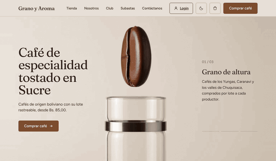
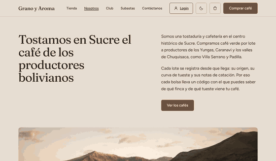
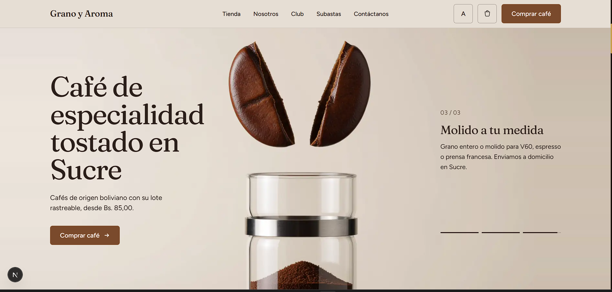
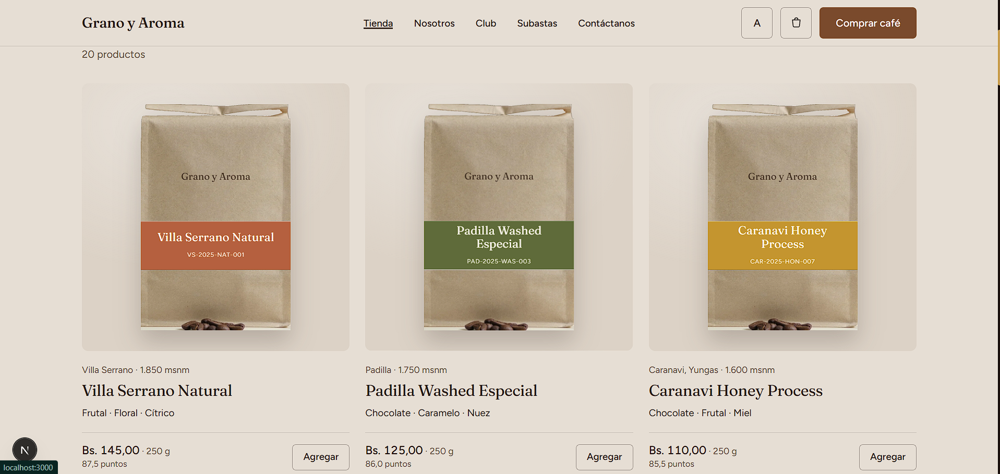
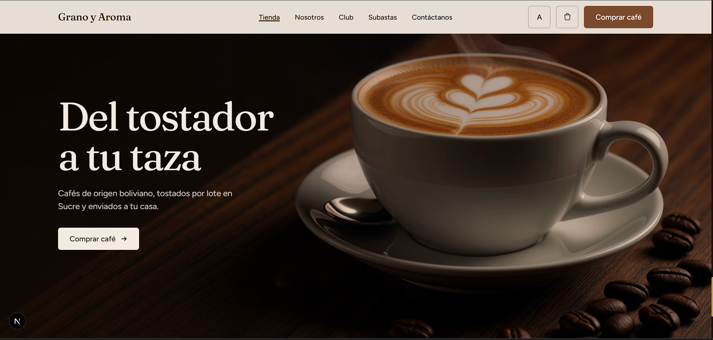
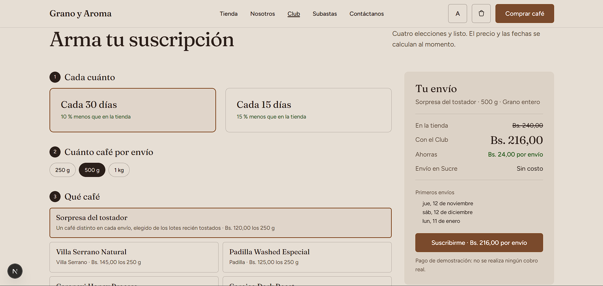
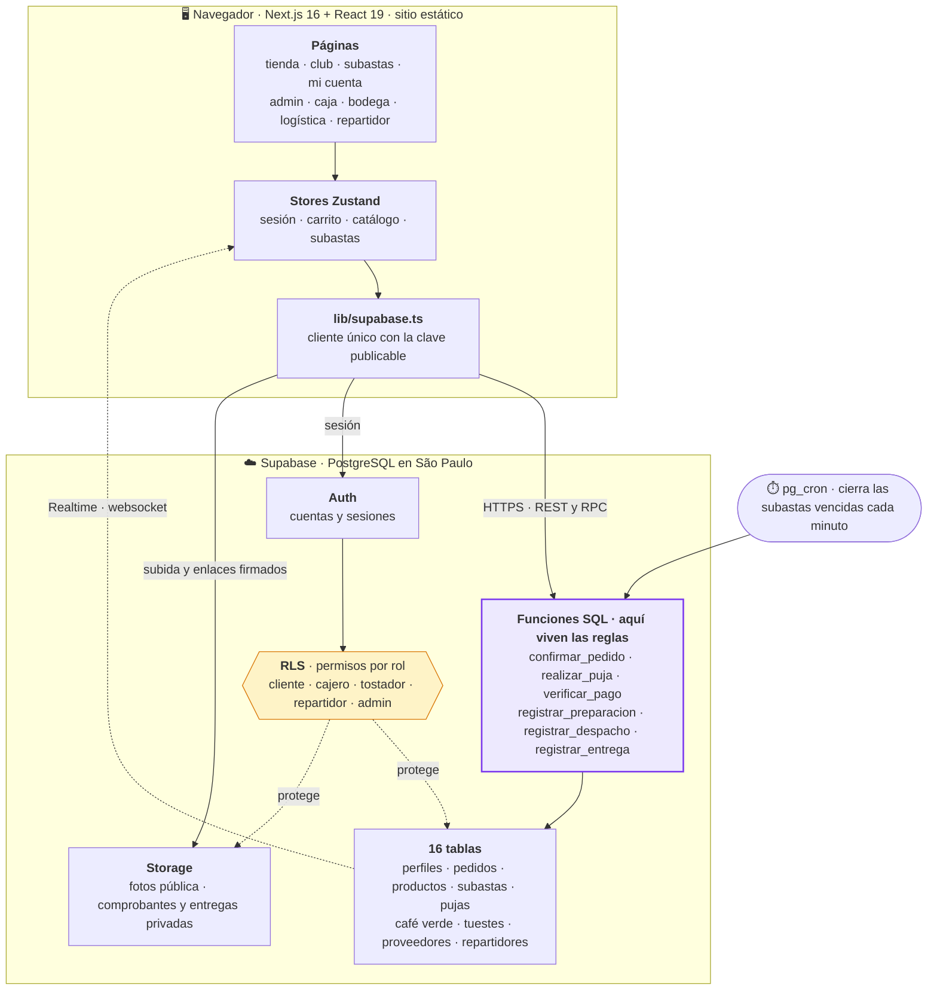

<div align="center">

# ☕ Grano y Aroma

**Comercio electrónico y gestión para una tostaduría de café de especialidad en Sucre, Bolivia.**
Del productor que vende el café verde hasta la foto de la entrega en la puerta del cliente.

[](https://grano-y-aroma-a0i0.onrender.com)




</div>

---

## El equipo

Proyecto de la materia **Ingeniería de Software** — USFX, Grupo 6.

| Integrante | Se ocupó de |
|---|---|
| **Calatayud Mamani, Alex Josué** | Backend, base de datos y autenticación |
| **Quispe Anagua, Jhon Christian** | Interfaz, trazabilidad de pedidos y documentos |
| **Chambi Condori, Janet** | Contenido, pruebas y documentación |

📄 **Documento de visión:** [`docs/Vision_del_Proyecto_G6.pdf`](docs/Vision_del_Proyecto_G6.pdf)

---

## Vista previa

### Modo claro y oscuro

El sitio entero cambia de tema con un botón, y recuerda la elección. La paleta oscura no es la clara invertida: es la misma identidad de café y madera, vista de noche.

<div align="center">



</div>

### Pantallas

| Inicio | Tienda |
|---|---|
|  |  |
| **Portada de la tienda** | **Club de suscripción** |
|  |  |

---

## Cómo probarlo

Se entra con el botón **Login**, arriba a la derecha. Los paneles del equipo se abren desde la inicial de la cuenta → **Panel del equipo**, o desde **Acceso del equipo** en el pie de la página.

| Rol | Correo | Contraseña | Qué abre |
|---|---|---|---|
| **Administrador** | `prueba.admin@granoyaroma.test` | `Cafe-Sucre-2026` | Todo: panel general, productos, subastas, usuarios, proveedores, caja, bodega y logística |
| **Cajero** | `cajero@granoyaroma.test` | *(ver con el equipo)* | Caja de la cafetería |
| **Tostador** | `tostador@granoyaroma.test` | *(ver con el equipo)* | Bodega, café verde, tueste y compras |
| **Repartidor** | `calosmamani@gmail.com` | `carlos123` | Solo sus entregas asignadas |

Cualquiera puede crear una cuenta de **cliente** desde Login para comprar, suscribirse al Club y pujar en las subastas. Son cuentas de prueba: no usan datos reales ni mueven dinero.

### Recorrido sugerido (5 minutos)

Este es el camino que muestra el sistema completo, y demuestra que las reglas se cumplen de punta a punta:

1. **Como cliente** — compra un café en `/tienda`. Si eliges pago por QR, el pedido queda esperando el comprobante.
2. **Como cliente** — en `/cuenta`, sube una captura cualquiera como comprobante de pago.
3. **Como administrador** — en `/logistica`, abre el comprobante, apruébalo y pasa el pedido a preparación: queda registrado quién lo preparó.
4. **Como administrador** — despacha el pedido eligiendo un repartidor de la lista.
5. **Como repartidor** — en `/repartidor`, confirma la entrega con foto, nombre de quien recibió y su firma.
6. **Como cliente** — vuelve a `/cuenta` y mira la constancia: la foto, la firma y quién recibió.

Prueba intermedia que vale la pena: en el paso 3, intenta pasar el pedido a preparación **sin aprobar el pago**. El sistema no te deja, y no porque el botón esté deshabilitado, sino porque la base de datos lo rechaza.

---

## Qué hace el sistema

| Módulo | Quién lo usa | Dónde |
|---|---|---|
| Tienda, carrito y pedidos | Cliente | `/tienda`, `/cuenta` |
| Club de suscripción | Cliente | `/club` |
| Subastas de micro-lotes en vivo | Cliente · Admin publica | `/subastas`, `/admin/subastas` |
| Punto de venta | Cajero | `/pos` |
| Bodega, café verde y tueste | Tostador | `/erp` |
| Proveedores y órdenes de compra | Tostador · Admin | `/admin/proveedores` |
| Logística y seguimiento | Admin | `/logistica` |
| Mis entregas | Repartidor | `/repartidor` |
| Productos, usuarios y reportes | Admin | `/admin`, `/admin/productos`, `/admin/usuarios` |

### Del pago a la puerta

Dos circuitos resuelven lo que un comercio electrónico necesita para ser creíble y son el núcleo del proyecto:

**Pago verificado.** El pedido por QR no avanza con la palabra del cliente. Este sube su comprobante, el equipo lo abre dentro de la misma pantalla —sin saltar de pestaña, que es como se cuelan los errores—, y lo aprueba o lo rechaza con un motivo que el cliente ve. Queda registrado quién revisó y cuándo.

**Entrega con constancia.** Cerrar un pedido no es apretar un botón. Cada etapa deja rastro de quién la hizo:

| Etapa | Qué exige el sistema |
|---|---|
| Preparación | Quién arma el pedido, con la hora y una nota para el equipo |
| Despacho | Qué repartidor lo lleva, elegido de una lista con su vehículo y teléfono |
| Entrega | Foto del lugar, nombre de quien recibió, en qué calidad, y su firma |
| Verificación | El administrador revisa la prueba y finaliza, o la devuelve con un motivo |

Solo el repartidor asignado puede confirmar su entrega: ni el administrador puede hacerlo por él. Con eso, un "a mí nunca me llegó" tiene respuesta.

---

## 🏗️ Arquitectura



### La idea central: el navegador no decide nada importante

> **El frontend muestra y pide. Las reglas que no se pueden saltar viven en la base de datos.**
> Siguen valiendo aunque alguien manipule la página o llame a la API por su cuenta.

- **Stock sin sobreventa.** `confirmar_pedido` bloquea cada producto (`SELECT … FOR UPDATE`), valida y descuenta en una sola transacción.
- **Un solo ganador por subasta (RNF-09).** `realizar_puja` bloquea el lote mientras registra la puja; `pg_cron` cierra los vencidos y crea la orden del ganador.
- **Sin pago aprobado no hay preparación.** Un disparador rechaza el cambio de estado, no el botón.
- **Sin evidencia no hay entrega.** Cerrar un pedido exige foto y nombre de quien recibió; un `UPDATE` directo al estado falla.
- **Cada quien lo suyo.** Row Level Security en las 16 tablas y en las carpetas de archivos. Los comprobantes y las fotos de entrega son privados y se abren con enlaces firmados que vencen en 10 minutos.

| Capa (como en los laboratorios por capas) | En este proyecto |
|---|---|
| Presentación (vista / controlador) | `src/app` y `src/components` |
| Servicio (casos de uso) | `src/store` + funciones SQL |
| Acceso a datos (repositorio) | `src/lib/supabase.ts` |
| Modelo | tablas de `supabase/migrations` + `src/lib/types.ts` |

**¿Por qué export estático?** El navegador habla directo con Supabase, así que el frontend no necesita servidor propio y se publica gratis en Render como sitio estático.

---

## 🛠️ Stack

| Capa | Tecnología |
|---|---|
| Frontend | Next.js 16 (App Router, export estático), React 19, TypeScript |
| Estilos | CSS propio con tokens de diseño y modo claro/oscuro (`src/app/tokens.css`) |
| Estado | Zustand |
| Backend | Supabase: PostgreSQL, Auth, Realtime, Storage, RLS, funciones SQL y pg_cron |
| Documentos | Comprobantes en PDF por impresión y reportes en Excel, sin dependencias externas |
| Despliegue | Render (Static Site) |

---

## 💻 Cómo correrlo en local

Requisitos: Node.js 20 o superior.

```bash
npm install
cp .env.example .env.local   # completa las dos variables de Supabase
npm run dev                  # http://localhost:3000
```

Las variables salen de Supabase → **Project Settings → API**: la *Project URL* y la clave **anon / publishable**. La clave `service_role` nunca va aquí.

```bash
npm run build   # genera el sitio estático en out/
npm run lint    # ESLint
```

### Base de datos

Las migraciones están en [`supabase/migrations`](supabase/migrations) y se ejecutan **en orden**, cada una con su propio *Run*, en Supabase → **SQL Editor**:

| Migración | Qué agrega |
|---|---|
| `001` | Usuarios, perfiles y roles |
| `002` | Tablas del negocio y RLS |
| `003` | Cierre de subastas y datos iniciales |
| `004`–`005` | Pujas públicas y subastas en vivo con pg_cron |
| `006` | La tienda lee el catálogo desde la base |
| `007` | Paneles del equipo: caja, bodega, tueste y logística |
| `009` | Fotos subidas, pago con comprobante y seguimiento por estados |
| `010` | Prueba de entrega: foto y nombre de quien recibió |
| `011` | Proveedores, órdenes de compra y constancia por etapa |
| `012` | Rol repartidor con cuenta propia y verificación de la entrega |
| `013` | Canje de puntos por descuento, con historial de movimientos |

Todas se pueden ejecutar más de una vez sin duplicar ni romper nada. El orden importa: de la `009` en adelante, cada una agrega reglas a funciones que define la anterior.

> No existe una migración `008`: el número se saltó durante el desarrollo y se dejó así para no renumerar lo ya aplicado.

Los roles se asignan desde el panel **Usuarios** del administrador. Al darle a una cuenta el rol *repartidor*, queda unida automáticamente a su ficha de reparto.

---

## Despliegue en Render

Static Site conectado a este repositorio:

| Campo | Valor |
|---|---|
| Branch | `main` |
| Build Command | `npm ci && npm run build` |
| Publish Directory | `out` |
| Variables | `NEXT_PUBLIC_SUPABASE_URL`, `NEXT_PUBLIC_SUPABASE_ANON_KEY`, `NODE_VERSION=22` |

Las variables tienen que estar cargadas **antes** de construir: Next las incrusta en el JavaScript durante el build.

### Sobre la clave pública

La clave anon viaja dentro del JavaScript y cualquiera puede verla con las herramientas del navegador. **Es así por diseño**: Supabase la llama *publishable*. Lo que protege los datos no es esconderla, sino las políticas RLS que deciden, fila por fila, qué puede leer y escribir cada rol. La clave `service_role`, que sí se salta RLS, nunca sale del panel de Supabase.

---

## 📁 Estructura

```
src/
  app/
    (publico)/    tienda, club, subastas, cuenta, login
    (equipo)/     admin, pos, erp, logistica, repartidor
    tokens.css    paleta, tipografía y modo claro/oscuro
  components/     componentes de UI por área
  lib/            cliente de Supabase, archivos, documentos, tipos
  store/          estado del cliente y casos de uso (Zustand)
supabase/
  migrations/     esquema, reglas de negocio y RLS
docs/             documento de visión, capturas y referencias de diseño
```

---

## Trazabilidad con el documento de visión

Dónde se demuestra cada módulo del documento. Lo que no está hecho también figura: un cuadro con todo en verde no se puede verificar.

| Módulo del documento | Estado | Dónde se ve |
|---|---|---|
| Ecommerce: catálogo, carrito, pago y trazabilidad del lote | ✅ | `/tienda`, `/cuenta` |
| Comprobante de compra | ✅ | Se descarga en PDF al confirmar el pedido |
| Cuenta, historial y seguimiento | ✅ | `/cuenta` |
| Club de suscripción | ✅ | `/club` |
| Subastas de micro-lotes en vivo | ✅ | `/subastas` · pujas en tiempo real |
| Punto de venta y cierre de caja | ✅ | `/pos` |
| Bodega, inventario y mermas | ✅ | `/erp` |
| Producción, tueste y trazabilidad por lote | ✅ | `/erp` · genera el código del lote |
| Proveedores y órdenes de compra | ✅ | `/admin/proveedores` |
| Logística y entregas con constancia | ✅ | `/logistica`, `/repartidor` |
| Administración, roles y reportes | ✅ | `/admin` · reportes en Excel y PDF |
| Cartera virtual y fidelización | ✅ | 1 punto por cada Bs. 10; se canjean en el checkout, con tope del 50 % e historial |

**Mejoras sobre el alcance**, que el documento no pedía: modo claro y oscuro, exportación de reportes a Excel, comprobantes en PDF, firma del cliente en la entrega y subastas con cierre automático.

---

## Forma de trabajo

- `main` siempre compila; Render publica cada cambio que entra.
- Cada funcionalidad va en su propia rama (`feat/…`, `fix/…`) y entra a `main` por Pull Request revisado por otro integrante.
- Los mensajes de commit van en español y describen el cambio.
- Cada regla de negocio nueva se escribe en una migración, no solo en el formulario.

---

## Créditos de imágenes

Las imágenes y videos del sitio se generaron con Kling AI, salvo dos fotografías de Wikimedia Commons:

- **Tueste:** [Jameswasswa](https://commons.wikimedia.org/wiki/File:Closer_look_at_the_coffee_beans_from_the_coffee_roasting_machine_looking_at_their_progress.jpg), CC BY-SA 4.0.
- **Tu taza:** [Kim Sanso](https://commons.wikimedia.org/wiki/File:Manual_drip_(pour-over)_coffee.jpg), CC0.

---

<div align="center">
<sub>Hecho en Sucre, Bolivia · USFX · Ingeniería de Software · Grupo 6</sub>
</div>
