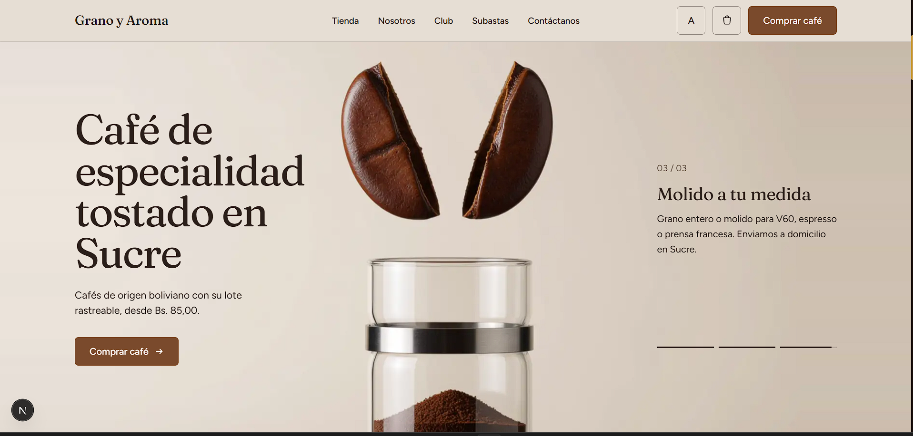
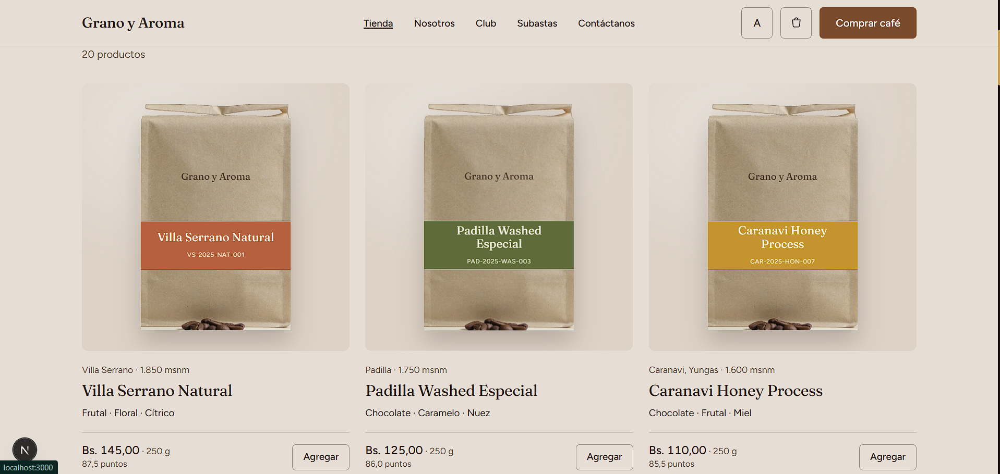
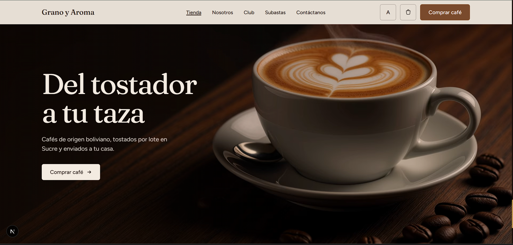
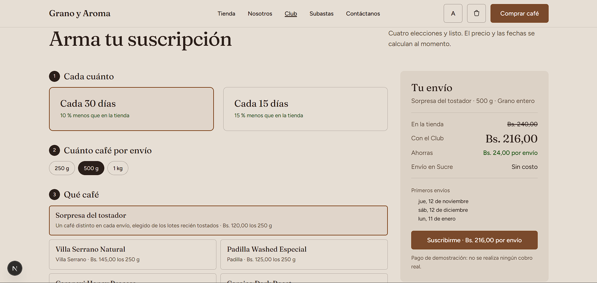
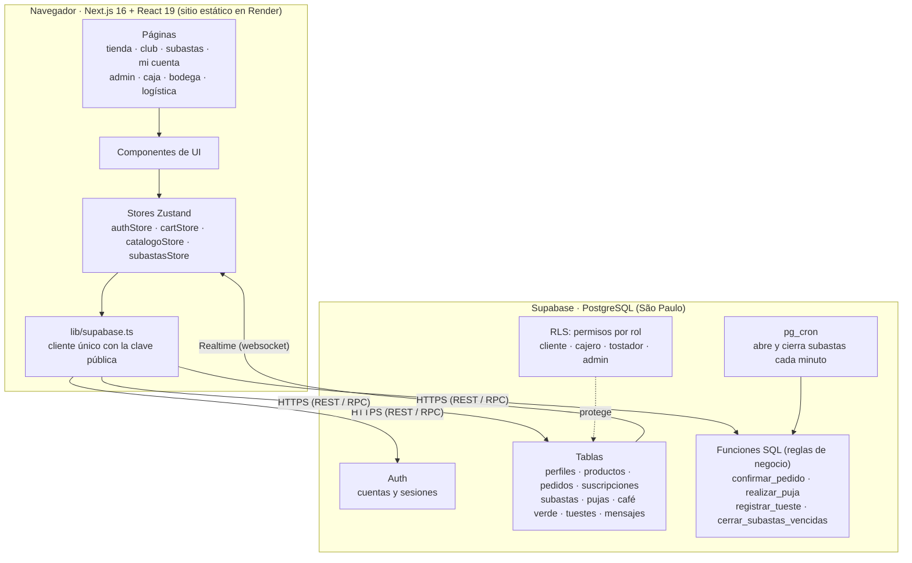

# Grano y Aroma

Plataforma de ecommerce y gestión para un negocio de café de especialidad (torrefactora y cafetería) en Sucre, Bolivia.

Proyecto de la materia **Ingeniería de Software** — USFX, Grupo 6:
Chambi Condori Janet · Calatayud Mamani Alex Josue · Quispe Anagua Jhon Christian.

**Sitio publicado:** https://grano-y-aroma-a0i0.onrender.com

El documento de visión está en [`docs/Vision_del_Proyecto_G6.pdf`](docs/Vision_del_Proyecto_G6.pdf).

## Vista previa

| Inicio | Tienda |
|---|---|
|  |  |
| **Portada de la tienda** | **Club de suscripción** |
|  |  |

## Usuarios de prueba

Para revisar el sistema con cada rol. Se entra con el botón **Login** (arriba a la derecha); los paneles del equipo se abren desde la inicial de la cuenta → **Panel del equipo**, o desde **Acceso del equipo** en el pie de la página.

| Rol | Correo | Contraseña | Qué puede ver |
|---|---|---|---|
| Administrador | `prueba.admin@granoyaroma.test` | `Cafe-Sucre-2026` | Todo: panel general, productos, subastas, usuarios, caja, bodega y logística |
| Cajero | `cajero@granoyaroma.test` | `<contraseña>` | Caja de la cafetería |
| Tostador | `tostador@granoyaroma.test` | `<contraseña>` | Bodega y tueste |

Cualquier persona puede crear una cuenta de **cliente** desde el botón Login para comprar, suscribirse al Club y pujar. Son cuentas solo de prueba: no usan datos reales.

## Arquitectura



**Idea central: el navegador no decide nada importante.** El frontend muestra y pide; las reglas que no se pueden saltar viven en la base de datos:

- **Stock sin sobreventa:** `confirmar_pedido` bloquea cada producto (`SELECT … FOR UPDATE`), valida y descuenta en una sola transacción.
- **Un solo ganador por subasta (RNF-09):** `realizar_puja` bloquea el lote mientras registra la puja; `pg_cron` cierra los lotes vencidos y crea la orden del ganador.
- **Permisos por rol:** Row Level Security en cada tabla. Aunque alguien manipule la web, la base rechaza lo que su rol no permite.
- **Tiempo real:** las pujas, el stock y los pedidos nuevos llegan a todos los navegadores abiertos sin recargar.

| Capa (como en los labs por capas) | En este proyecto |
|---|---|
| Presentación (controller / vista) | `src/app` y `src/components` |
| Servicio (casos de uso) | `src/store` + funciones SQL |
| Acceso a datos (repository) | `src/lib/supabase.ts` |
| Modelo | tablas de `supabase/migrations` + `src/lib/types.ts` |

**¿Por qué export estático?** El frontend habla directo con Supabase, así que no necesita un servidor propio y se publica gratis en Render como sitio estático.

## Stack

| Capa | Tecnología |
|---|---|
| Frontend | Next.js 16 (App Router, export estático), React 19, TypeScript, Tailwind CSS 4, Zustand |
| Backend | Supabase: PostgreSQL, Auth, Realtime, RLS, funciones SQL (RPC) y pg_cron |
| Despliegue | Render (Static Site) |

## Módulos

| Módulo | Quién lo usa | Ruta |
|---|---|---|
| Tienda en línea, carrito y pedidos | Cliente | `/tienda`, `/cuenta` |
| Club de suscripción | Cliente | `/club` |
| Subastas de micro-lotes en vivo | Cliente · Admin publica | `/subastas`, `/admin/subastas` |
| Punto de venta (caja) | Cajero | `/pos` |
| Bodega, café verde y tueste | Tostador | `/erp` |
| Logística de pedidos | Admin | `/logistica` |
| Productos, usuarios y reportes | Admin | `/admin`, `/admin/productos`, `/admin/usuarios` |

## Cómo correrlo en local

Requisitos: Node.js 20 o superior.

```bash
npm install
cp .env.example .env.local   # completa las variables de Supabase
npm run dev                  # http://localhost:3000
```

Otros comandos:

```bash
npm run build   # genera el sitio estático en out/
npm run lint    # ESLint
```

### Base de datos

Las migraciones están en [`supabase/migrations`](supabase/migrations) y se ejecutan **en orden** en Supabase → SQL Editor (`001` a `007`, cada una con su propio *Run*). Para asignar roles a las cuentas del equipo se usa el panel **Usuarios** del administrador.

## Despliegue en Render

Static Site conectado a este repositorio:

- **Branch:** `main`
- **Build Command:** `npm ci && npm run build`
- **Publish Directory:** `out`
- **Variables:** `NEXT_PUBLIC_SUPABASE_URL`, `NEXT_PUBLIC_SUPABASE_ANON_KEY` y `NODE_VERSION=22`

Solo se usa la clave pública de Supabase; la clave secreta nunca va en el frontend.

## Estructura

```
src/
  app/          páginas (App Router): (publico) tienda, club, subastas, cuenta · (equipo) admin, pos, erp, logistica
  components/   componentes de UI
  lib/          cliente de Supabase, tipos y utilidades
  store/        estado del cliente y casos de uso (Zustand)
supabase/       migraciones SQL (esquema, reglas y RLS)
docs/           documento de visión, capturas y referencias de diseño
```

## Forma de trabajo

- `main` siempre debe compilar; Render publica cada cambio que entra a `main`.
- Cada funcionalidad va en su propia rama (`feat/…`, `fix/…`) y entra a `main` por Pull Request.
- Los mensajes de commit van en español y describen el cambio.

## Créditos de imágenes

Las imágenes y videos del sitio se generaron con Kling AI, salvo dos fotografías de Wikimedia Commons:

- **Tueste:** [Jameswasswa](https://commons.wikimedia.org/wiki/File:Closer_look_at_the_coffee_beans_from_the_coffee_roasting_machine_looking_at_their_progress.jpg), CC BY-SA 4.0.
- **Tu taza:** [Kim Sanso](https://commons.wikimedia.org/wiki/File:Manual_drip_(pour-over)_coffee.jpg), CC0.
